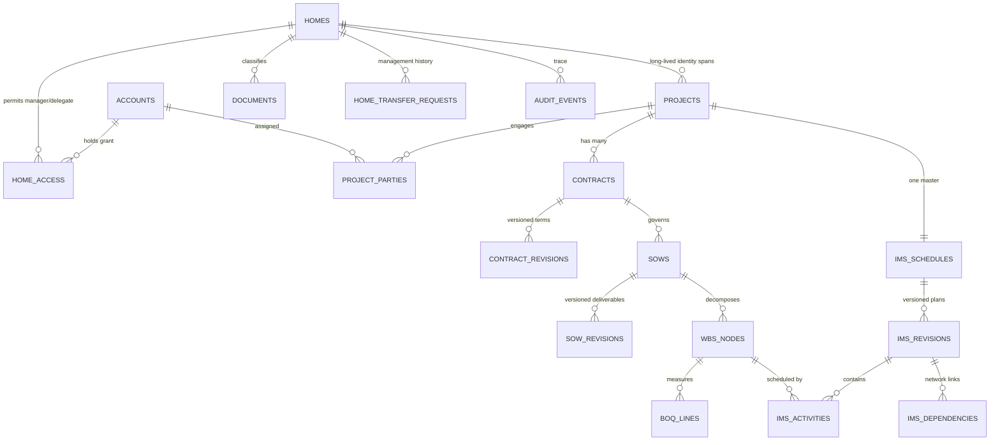

# BAITNA — Domain model, authority matrix and invariants
**DTD 0.1 | 2026-11-17 | Design only**

## 1. ERD — structural overview



**Home** = permanent and reusable identity for lifecycle. **Account** = person's application identity, not a legal title holder. **Project** = scope of a particular new build, extension, renewal or maintenance programme. **HomeRef** is a separate immutable opaque label, not geospatial or cadastral number. A project may have many contracts/SOWs, but **exactly one master IMS** with many immutable schedule versions and one selected approved current baseline.

## 2. Ownership and authorization

**Home management grants:** `home_access`
- `owner_manager`: exactly one active BAITNA home-record manager in MVP. Transfer atomically revokes prior manager and assigns new manager. This is NOT a legal land owner register. Multi-owner/joint-owner support requires separate delegated accounts and a later verified legal/consent model.
- `owner_delegate`: invited by active manager; manage permitted project activities but cannot transfer the digital record or change ownership policy.
- `home_viewer`: view a curated non-sensitive record, never bulk-export owner-private documents.
- A home grant is not global authority over all project-party confidential terms; the document class still applies.

**Project party grants:** `project_parties`
- `main_contractor`: draft updates to work packages and evidence only for assigned project and contract; cannot approve own inspection.
- `subcontractor`: limited assigned WBS nodes and media; no project-wide financial details.
- `consultant`: verification/engineering inspection for assigned project and commissioned scope; not owner payment release.
- `project_manager`: schedules visits and coordinates changes within explicit delegation; cannot self-certify work.
- `project_viewer`: report-only, least-privilege.
- `system_administrator` and future `programme_authority` need explicit supervised-service roles not implied by project party lists. No global "government sees everything" role.

**Permission matrix (initial)**

| Action | Owner manager | Delegate | Contractor | Subcontractor | Consultant | PM | Viewer |
|---|---|---|---|---|---|---|---|
| Create project | Allow | Allow with grant | No | No | No | No | No |
| Read own home's overview | Allow | Allow | Restricted assigned | Restricted assigned | Assigned | Assigned | Allowed curated |
| Draft contract/SOW | Allow | Delegated | Assigned draft only | No | Assigned review | Delegated | No |
| Approve contract revision | Only if legal mandate/workflow | No by default | No | No | No | No | No |
| Draft IMS activity | Allow | Delegated | Assigned | Own assigned node | Propose | Delegated | No |
| Approve IMS baseline | Delegated named approver with required checks | No default | No | No | Only if explicit mandate | Only if explicit mandate | No |
| Submit site evidence | Review own | No default | Assigned | Assigned | Field-review | Assigned | No |
| Engineering verification | No | No | No | No | Assigned consultant | Only if separately authorized | No |
| Approve owner's payment instruction | Allow (after consultant review) | Only explicit delegation | No | No | No | No | No |
| View bank/tax personal records | Own-only | No default | No | No | No default | No default | No |
| Initiate digital-record transfer | Allow only with two-party checks | No | No | No | No | No | No |

Policies are **deny by default**: a role grants an action only when the exact Home/Project/WBS/Document scope, purpose, state and explicit delegation also pass. Matrix is not an electronic-signature or legal-approval guarantee.

## 3. Security and query scoping

Every GET/POST/approval must resolve:
`verified identity -> account -> active home grant and/or project party -> object-project-home chain -> resource disclosure class -> lifecycle action eligibility`.

For cross-home identifier access, respond with indistinguishable 404 when appropriate. Never rely on UI hiding, UUID opacity or HomeRef alone. Project-specific contract terms must not be automatically visible to unrelated subcontractors.

**RLS migration order:** `0001_core.sql` sets all sensitive tables to default-deny (enabled RLS, zero permissive policies). A dedicated, reviewed `0002_authorization.sql` must introduce least-privilege application grants and policies after identity/session design is finalized. Backend MUST use a non-owner DB role that cannot `BYPASSRLS`, with trusted actor context set inside each transaction by the server AFTER validating the OIDC token; no direct database access from public clients. Add tests for staff, owners, cross-home and archive access. Never ship just the initial DDL as a functional platform.

## 4. Versioning and business legality

- `contract_revisions` and `sow_revisions` are independent records. Once state = approved they are immutable; a subsequent request creates revision N+1, retaining previous evidence and approvals.
- `sows.incorporation_status` is a recorded legal/documentary *status claim*. Actual legal incorporation requires contract reference, proper authorization and supporting instrument; the app cannot create legal effect solely by toggling a flag.
- `ims_revisions` snapshot the complete schedule activity network. Approved revisions are immutable; `ims_schedules.current_baseline_revision_id` can change only through approved change control. Forecast calculations (early/late starts, float, CPM) are stored separately later, never directly into baseline.
- `change_requests` record proposed time/cost/scope impact and approvals; implementation may create new SOW revision, a **separate contract amendment** where required, and new IMS baseline; those are not automatic mutual amendments.
- The SQL FKs prevent WBS–SOW–project and IMS–WBS cross-project mismatches. **Service-layer** also checks that activity responsible party matches project and that attached document matches contract's project/home.

## 5. Formal workflow transitions

```text
Contract revision  : draft -> submitted -> approved | rejected
SOW revision       : draft -> submitted -> approved | rejected
IMS revision       : draft -> submitted -> approved | rejected
Change request     : draft -> submitted -> under_review -> approved | rejected
                                              approved -> implemented (after linked amendment/IMS)
Home management    : requested -> accepted -> under_review -> completed
                             \-> declined / cancelled / expired
```

Approvals require explicit authorized actor IDs, audit event, date/time, source record and expected row version. Do not label a mere UI button click a legal UAE PASS signature. All irreversible transitions need concurrency and idempotency protection.

For IMS:
1. Service validates all FK scope, dates and dependencies; rejects self links and *all graph cycles* (recursive graph check; the current DDL only rejects direct self link).
2. CPM/lag semantics must be deterministic; selected calendar rules (weekends/public holidays/working days/lag) are explicit project configuration and must not be silently inferred.
3. Role-approved submission takes transaction lock on `ims_schedules`, checks ETag/version, updates approved revision and baseline pointer, writes audit event; concurrent attempts are rejected.
4. The previous baseline remains queryable; approved activities/dependencies cannot mutate.
5. Forecasts use actual reported progress, remaining durations, resource/calendar constraints and separately identified assumption sets. A critical path alone is not proof of fault or contractual entitlement.

## 6. File and transfer classification (most important long-term invariant)

| Classification | Examples | Default transfer to new manager |
|---|---|---|
| `home_technical` | As-built plans, inspections, equipment data, maintenance history | Included after verification and disclosure check |
| `restricted_contract` | Contract/SOW annexes, claims, contractor details | Case-by-case disclosure and redaction |
| `owner_private` | Personal messages, personal addresses/IDs | Excluded |
| `owner_financial` | Bank statements, owner-specific claims and tax identity | Excluded |
| `identity_private` | UAE PASS/ID or verification proofs | Excluded |

The **transfer is of the BAITNA digital record manager role and permitted record access**, NOT ownership of the real estate nor unqualified copyright transfer of design documents.

Data transfer invariants:
1. `Home.id` and `Home.home_ref` unchanged. Technical passport and lifecycle events remain attached to same home.
2. Current `owner_manager` and invited new account explicitly consent; entitlement is reviewed using suitable evidence. The current MVP does NOT use automated property-registry verification.
3. Enumerate and preview classes of data to disclose; redaction/restrictions are applied *server-side*.
4. Under one transaction: verify still-current manager, accepted target, unexpired request, data manifest, authorization → revoke prior owner_manager grant → create new grant → mark transfer completed → audit.
5. Prior manager loses owner-management permissions, but its necessary historical audit linkage remains; active user sessions and expiring URLs must be invalidated according to security design.
6. Failure at any step rolls back everything; duplicate/replayed transfer cannot affect the Home ID or inadvertently export restricted data.

## 7. Storage, operational controls and data lifecycle

- Private encrypted object storage; signed URLs short-lived and strictly per classified document, virus scanning and MIME validation before acceptance. `sha256` is integrity metadata, not evidence of honest site origin.
- Retention: classify by record obligations/purpose, permit deletion or restricted archival where lawful, preserve technical continuity, cryptographic backups, periodic export, schema migrations and restore drills. Long-lived Home ID does not imply endless storage of every former owner's personal data.
- Audit: database append-only trigger is a guard, not absolute immutability against administrators. Production needs restricted admin access, mirrored append-only event sink, monitoring and immutable retention of material decisions.
- Design future geolocation as **indicia**, with geofence + device signals + signed timestamp + reviewer approval. An ordinary GPS coordinate is spoofable.
- Tax eligibility, bank decision, legal project warranties, government approvals and property transfer remain with their respective competent entities.

## 8. Integrity gaps intentionally deferred beyond schema 0001

The SQL migration provides relational FKs and immutable revisions but still needs:
- RLS policies and application grants (not yet implemented)
- valid-state transition triggers or verified service transactions, including approval authority
- complete WBS recursion cycle validation and broader dependency DAG cycle rejection
- document-to-contract same-home verification
- explicit per-activity responsible party same-project verification
- controlled identity/owner-manager transfer flow and ETag semantics
- complete domain tables for site media, invoices, warranty, assets and scheduled maintenance
- operational archive, key management, backup, restore and disaster recovery

These are **open engineering tasks**, not capabilities delivered by current SQL files.
