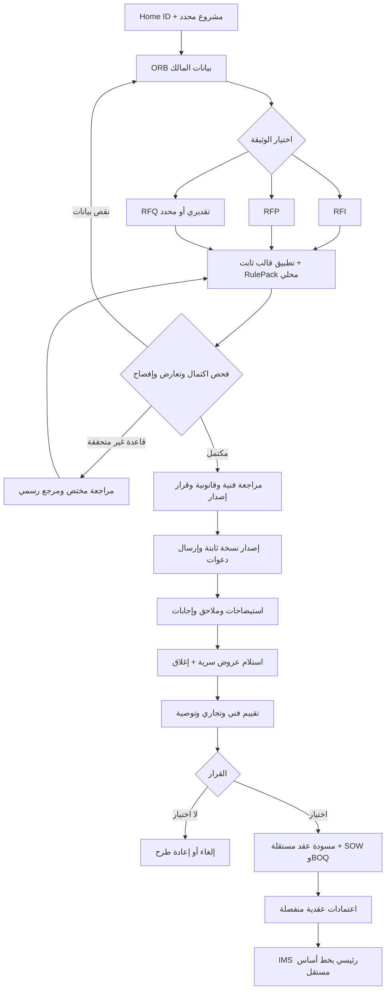
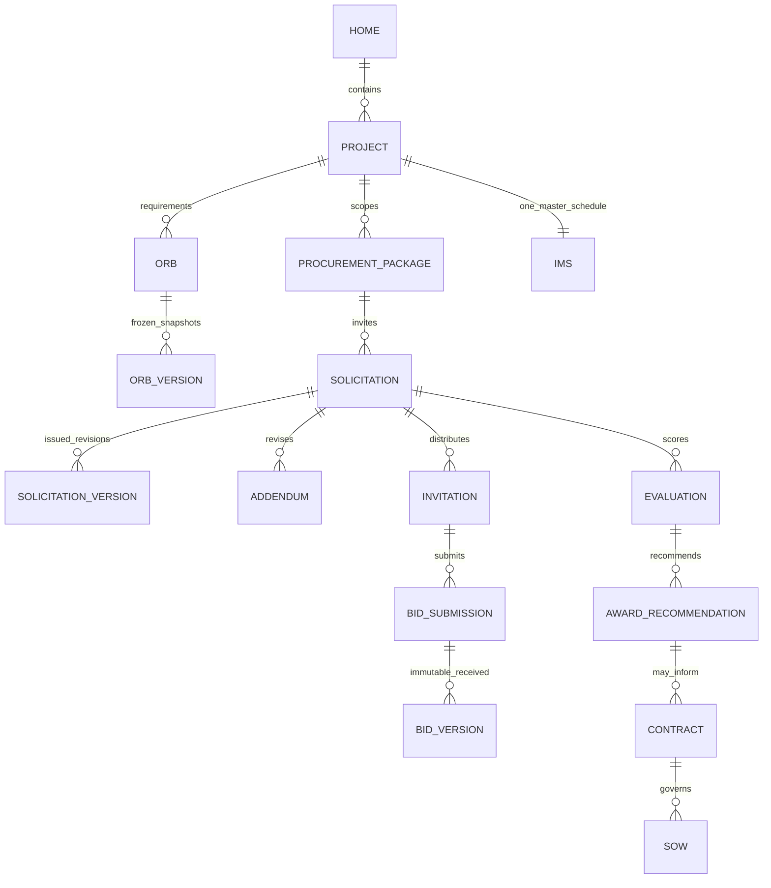

# BAITNA — Document Generation, Review, Evaluation & Traceability
## محرك إنشاء الوثائق والتحكم وإجراءات القبول

**Design version DTD 0.2 — 2026-11-17** | **المجال:** ORB → RFI/RFP/RFQ → contract/SOW/IMS. **لم يُنفذ برمجياً.**

### 1. اتخاذ قرار نوع الطلب (Decision Assist, not mandatory sequence)
| حالة المشروع | التوصية الأولية | السبب | الاستثناء |
|---|---|---|---|
| فكرة مبكرة وحاجة لمعرفة قدرات السوق | RFI | نقص معلومات السوق | يمكن الانتقال إلى RFP بلا RFI |
| متطلبات وظيفية/أداء مع حلول ومنهجيات مفتوحة | RFP | يتطلب مقارنة فنية وتجارية | قد تُرفق قائمة أسعار |
| بنود BOQ ومواصفات وكميات واضحة | RFQ — Firm scope | مقارنة تسعير لبنود متجانسة | يتطلب التأكد من اكتمال النطاق |
| رغبة في رقم تقريبي والوثائق غير مكتملة | RFQ — Budgetary | تقدير أولي غير ملزم | يحظر وصفه بالسعر النهائي |
| استدراج شراكة تصميم/تنفيذ | RFP (مع Financial Schedule) | نموذج الحل مهم وليس السعر فقط | يمكن طلب RFQ لاحقاً |

### 2. سير إعداد وإصدار الوثيقة

### 3. النسخ والحالات
- ORB: `DRAFT → OWNER_CONFIRMED → PROFESSIONAL_REVIEWED → APPROVED_FOR_GENERATION`؛ كل نسخة snapshot غير متغيرة بعد استخدامها في إصدار.
- Document: `DRAFT → COMPLETENESS_CHECK → PROFESSIONAL_REVIEW → LEGAL_REVIEW → APPROVED_FOR_ISSUE → ISSUED → CLOSED → EVALUATED → ARCHIVED`؛ مسار `CANCELLED` مع سبب.
- Addendum: ينشأ من الوثيقة المصدرة، يحدد البنود المتأثرة وتاريخ السريان، ويُرسل بالدرجة نفسها من الإفصاح لجميع المخاطبين المتأثرين؛ لا تغيير صامت.
- Bid: `DRAFT → SUBMITTED → VALIDATED → OPENED_FOR_AUTHORIZED_REVIEW → EVALUATED → SELECTED/REJECTED`، مع سجل من/متى/أي إصدار، وحفظ السرية.
- Award recommendation: توصية موثقة وموافقة المالك المخول؛ **ليست عقداً أو توقيعاً قانونياً**.

### 4. Traceability Map — لا يسقط أي حقل
| المصدر | في مرحلة الطرح | بعد الاختيار | ضوابط |
|---|---|---|---|
| ORB project requirements | RFI/RFP/RFQ annex | Contract reference + SOW draft | نقل النسخة الموافق عليها فقط |
| Draft SOW | RFP scope requirements | SOW agreement after authorization | لا يتغير عقد تلقائياً |
| BOQ/price table | RFQ / financial annex | BOQ agreed lines | الكميات/الأسعار مع الاستثناءات |
| Bidder technical methodology | Technical submission | potential construction method / deliverables | يحتاج مراجعة فنية وتضمين تعاقدي |
| Bidder target programme | proposed schedule | draft IMS activities | IMS baseline يحتاج اعتماد مستقل |
| Exceptions & clarifications | clarifications / deviation log | contract negotiation log | لا تُخفى الاستثناءات |
| Jurisdiction RulePack | local annex references | compliance checklist | ما لم يُتحقق منه يبقى غير ملزم آلياً |
| Award recommendation | evaluation decision | source record to contracts | لا يعني وجود عقد نافذ |

### 5. تحرير الشروط القانونية
- **منشئ قالب (Template Author):** متخصص مفوض يحرر مسودات القياسية فقط.
- **مراجع قانوني (Legal Reviewer):** يعتمد الشرط القياسي في نطاق اختصاصه ويثبت النسخة والمراجعة.
- **مراجع فني محلي (Technical Reviewer):** يراجع المواصفات وRulePack وتطبيقه على قطعة الأرض ونوع المشروع.
- **المالك (Owner):** يغيّر حقول احتياجاته، ولا يغيّر النصوص الملزمة أو نسخ المرجعيات الرسمية.
- **متنافس (Bidder):** يرى فقط الدعوات الموجهة له ونسخها العامة وعرضه الخاص، وليس عروض غيره أو التقييم الداخلي.
- **مدير المشروع/الاستشاري (Delegated PM/Consultant):** يعدّ وثيقة وتوصية ضمن تفويض؛ لا ينفذ اتفاقاً باسم المالك بدون صلاحية.
- نشر حقيقي يتطلب backend authentication وRBAC/ABAC، وليس تبديل الدور في JavaScript أو تخزين ملفات على GitHub Pages.

### 6. هيكل الحزمة التقنية (Conceptual ERD)

### 7. التصميم الفني للوثيقة المُصدرة
`GeneratedDocument` يجب أن يحتفظ بــ `home_id`, `project_id`, `orb_revision_id`, `template_id/version`, `rulepack_id/version`, `jurisdiction_authority_id`, `solicitation_id`, `document_hash`, `issued_at`, `issued_by`, `approval_chain`, `attachment_manifest`, `redaction_manifest`, `language`, `rendered_file_ref`, `parent_version_id`. يمنع تعديل نسخة ISSUED؛ أي تغيير يؤدي إلى Addendum جديد ويحتفظ بالسجل الأصلي.

### 8. اختبارات قبول — Before coding
| Test | Given → When → Then |
|---|---|
| ORB-01 | مالك ينشئ مشروعاً تحت Home A → ORB يرتبط بـA وبالمشروع نفسه، ولا يُنشئ Home ID جديداً |
| ORB-02 | اختيار pool=true → تظهر أسئلة المسبح؛ false → لا تظهر ولا تفرض إجابات غير لازمة |
| ORB-03 | المالك لا يعرف كميات التشطيب → RFQ نهائي يُرفض/يوجّه لـ Budgetary أو RFP |
| ORB-04 | RFP مجموع أوزانه 90% → يعرض خطأ قبل الإصدار |
| ORB-05 | تصنيف رقم القسيمة restricted → لا ينتقل لملحق الموردين إلا بإذن/مراجعة |
| ORB-06 | RulePack لجهة غير متحققة → لا تدّعي الوثيقة «مطابقة قانونية» ولا تنشر البنود الملزمة |
| ORB-07 | مالك أبوظبي يبني نموذجاً لمشروع آخر في دبي → يختار RulePack دبي ولا يعيد استخدام متطلبات أبوظبي تلقائياً |
| ORB-08 | عند إصدار RFP ثم تعديل ORB → لا تتغير النسخة المصدرة؛ يصدر Addendum مع إخطار |
| ORB-09 | متنافسان على RFQ → لا يطلع أحدهما على مستندات وأسعار الآخر |
| ORB-10 | مهندس يقترح تعديل بند قياسي محمي → يحال لصلاحية Template Author/Legal Reviewer مع سجل تدقيق |
| ORB-11 | RFI استكشافي → لا يطلب سعراً نهائياً ولا يتطلب BOQ مفصلاً |
| ORB-12 | اختيار عرض RFP → ينشئ مسودات Contract/SOW وIMS لا عقوداً نافذة أو جداول معتمدة تلقائياً |
| ORB-13 | اختيار عرض Budgetary → لا يظهر «السعر النهائي» أو «العرض الملزم» |
| ORB-14 | تعارض شرط المالك مع مصدر محلي إلزامي محقق → منع إصدار حتى الفصل المهني وتوثيق التغيير |
| ORB-15 | طلب لا يحمل هوية صاحب الحق المخول → يمنع إرساله حقيقياً ويُحفظ مسودة فقط |
| ORB-16 | مستند أصدر قبل تحديث RulePack → يحتفظ بإصدار القواعد المرجعية القديم دون تعديلات صامتة |
| ORB-17 | بند من UAQ بلا مصدر محلي تفصيلي محقق → توجيه إلى مراجعة بشرية دون اختراع متطلب |
| ORB-18 | مستخدم خارج المشروع يحاول قراءة مستند أو بيانات مالك → رفض على مستوى الخادم والتخزين |

### 9. قرارات قبل البرمجة
1. تثبيت تقني لمسارات الإصدار والتعديل والملحقات وفق مراجعة متخصصة.
2. بناء سجل مصادر رسمي حيّ بمالك مسؤول عن التحديث والتنبيه وتوثيق الحالة.
3. الاتفاق على سياسات صلاحيات الأطراف وخصوصية العطاءات ومستندات الملاك.
4. تنفيذ ORB في بيئة خاصة مصدقة أولاً، ثم اختبار نماذج RFI/RFP/RFQ ببيانات تجريبية ومقارنة الإصدارات والتعارضات.
5. عدم نشر مستندات حقيقية عبر صفحات GitHub العامة.